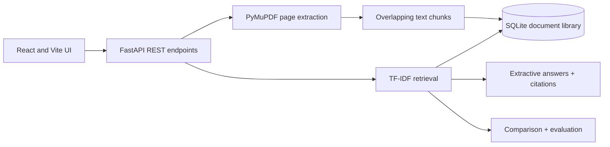

# ResearchPilot AI Pro — Evidence-First Research Intelligence

**Live locally · React + FastAPI · Hybrid retrieval · Optional LLM · Citation validation · Research benchmarks**

ResearchPilot AI Pro expands the earlier extractive academic PDF assistant into a **research engineering portfolio platform**. Upload PDFs, retrieve page-linked excerpts, ask source-grounded questions, compare papers, and evaluate the search system with labeled relevance judgments.

> **Scope and integrity:** This is a local-first prototype, not a production-secure multi-user platform. It does not verify whether claims are true. LLM citations are checked for valid source numbers, NOT for factual entailment. Do not upload sensitive PDFs to a public unauthenticated server.

## Features

| Capability | Implementation | Status |
| --- | --- | --- |
| PDF ingestion and page-linked passages | PyMuPDF, chunking and SQLite | Included |
| Lexical search | TF-IDF and cosine similarity | Included |
| Semantic retrieval | Sentence Transformers / MiniLM | Optional package; first use may download weights |
| Hybrid retrieval | Reciprocal-rank fusion, lexical fallback | Included |
| Evidence-first answers | Extractive evidence passages and citations | Included |
| AI-generated answers | OpenAI-compatible Chat Completions API | Optional paid key / model access |
| Citation reference validation | Checks returned [n] IDs against retrieved evidence | Included; **not factual verification** |
| Multi-document comparison | Side-by-side retrieved evidence | Included; not automatic verified synthesis |
| Benchmark lab | Precision@k, Recall@k, MRR, nDCG@k, latency | Included API, requires user-labeled relevant chunk IDs |
| Usage overview | Document/page/chunk counts and optional feature availability | Included |
| Testing | pytest API integration + advanced endpoint tests | Included |
| Auth / user isolation | Not implemented | Future hardening |
| Persistent production database / migrations | Local SQLite | Future hardening |
| OCR for scanned documents | Not included | Future upgrade |

## Windows quick start

Open two Visual Studio Code terminals **inside the extracted project folder**.

**Terminal 1 — backend:**
```powershell
cd backend
py -3.12 -m venv .venv
.\.venv\Scripts\python.exe -m pip install -r requirements.txt
.\.venv\Scripts\python.exe -m uvicorn app.main:app --reload --port 8000
```

**Terminal 2 — frontend:**
```powershell
cd frontend
npm.cmd install
npm.cmd run dev
```

Visit **http://localhost:5173/** and choose **AI Research Studio** in the left navigation. API docs: **http://localhost:8000/docs**.

### Optional semantic retrieval

Stop the backend (Ctrl+C), then from `backend/` run:
```powershell
.\.venv\Scripts\python.exe -m pip install -r requirements-semantic.txt
.\.venv\Scripts\python.exe -m uvicorn app.main:app --reload --port 8000
```

The model is loaded lazily when semantic/hybrid search is used. First download requires internet and may take time and disk space. Hybrid mode falls back to lexical-only when embeddings are unavailable. The endpoint records the requested mode rather than a full provenance log of fallback.

### Optional generative synthesis

In **your own local backend terminal**, set these environment variables before starting Uvicorn:
```powershell
$env:OPENAI_API_KEY="YOUR_PRIVATE_API_KEY"
$env:OPENAI_MODEL="gpt-4.1-mini"
```
Never place the key in React, GitHub, commits, screenshots, or browser environment variables. Provider pricing and model availability vary. If not configured, choose **Grounded passages · free** mode.

### API (additional endpoints)

- `POST /api/v2/search` — `question`, `document_ids`, `top_k`, `retrieval_mode`
- `POST /api/v2/ask` — above plus `answer_mode: extractive|llm`
- `POST /api/v2/benchmark` — labeled `cases` containing `question`, `relevant_chunk_ids`, optional `document_ids`, plus `k` and `mode`
- `GET /api/v2/stats` — storage and optional feature overview

Earlier `/api/documents`, `/api/search`, `/api/ask`, `/api/compare`, `/api/evaluate`, and `/api/health` routes remain available.

**Benchmark example**: Retrieve results from `/api/v2/search`, manually mark truly relevant `chunk_id` values, then submit:
```json
{
  "k": 5,
  "mode": "lexical",
  "cases": [{"question": "Which methods were used?", "relevant_chunk_ids": ["PASTE_REAL_RELEVANT_CHUNK_ID"]}]
}
```

Benchmark scores are meaningful only if relevance labels are accurate. `Precision@k` counts retrieved relevant passages divided by `k`; MRR and nDCG measure ranking. None prove generated-answer correctness.

### Run tests
```powershell
cd backend
.\.venv\Scripts\python.exe -m pytest -q
```

## Limitations and security

- **No authentication or user isolation**: do not expose to public internet without proper controls. Shared backend users could access or delete all uploaded documents.
- Document content is treated as **untrusted** and the optional model is instructed to ignore embedded instructions, but prompt injection cannot be fully prevented.
- PDF text extraction does not support scanned-image OCR.
- Semantic retrieval recomputes embeddings on each search; optimize with a persisted index for large libraries.
- Optional AI calls transmit retrieved snippets to the configured provider; consider privacy and consent.
- Citation-format checks do not establish entailment, correctness, or completeness.
- Local SQLite is intended for prototype use, not concurrent multi-tenant production.

## Recommended next milestone

Add auth and workspaces, persistent vector index, evaluation corpus with manually adjudicated relevance judgments, citation-to-claim entailment tests, OCR, Playwright E2E, monitoring, and hardened cloud deployment.

---
Built as a portfolio engineering prototype by **Aqib Ali** · [GitHub](https://github.com/aqibsolangiali) · [LinkedIn](https://www.linkedin.com/in/aqib-ali-54b872443)


## Original v1 documentation archive

# ResearchPilot AI — Evidence-first academic research workspace

> **Full-stack, local-first research assistant** for importing PDFs, finding relevant passages, citing source pages, comparing documents, and measuring retrieval performance.

## Highlights

- **Multi-PDF ingestion:** validates PDF format, enforces 12 MB / 150 page limits, extracts per-page text with PyMuPDF, and creates overlapping passages.
- **Cited research answers:** extracts relevant source sentences and shows the original passages with PDF name and page numbers; explicitly states when evidence is insufficient.
- **Research search:** weighted TF–IDF word and phrase retrieval, top-k ranking, and relevance scores.
- **Cross-paper comparison:** presents evidence from multiple papers side by side for reviewing methods, findings, and limitations.
- **Evaluation lab:** batches test questions; reports retrieval coverage, scores, and latency. **Coverage is not ground-truth accuracy.**
- **Research library:** documents stored in SQLite with per-page chunks, delete support, and document scoping.
- **Polished React frontend:** interactive library, document upload, grounded Q&A, source panels, comparison, evaluation, mobile-responsive interface.
- **Tests and CI:** pytest/FastAPI tests plus GitHub Actions for backend and frontend builds.

## Architecture



## Local development

**Requirements:** Python 3.11–3.13, Node.js 22 LTS, npm. If using Python 3.14 or Node.js 26, some dependencies may behave differently; use the recommended versions if installation fails.

**Terminal 1: API**

```powershell
cd backend
py -3.12 -m venv .venv
.venv\Scripts\python.exe -m pip install -r requirements.txt
.venv\Scripts\python.exe -m uvicorn app.main:app --reload --port 8000
```

For macOS/Linux, create and activate your virtual environment with your platform's Python executable and run the same pip/uvicorn commands. The backend health route is `http://localhost:8000/api/health`, and interactive API docs are at `http://localhost:8000/docs`.

**Terminal 2: React UI**

```powershell
cd frontend
npm install
npm run dev
```

Open **http://localhost:5173**. Local Vite development proxies `/api` to the backend automatically.

## Production-style deployment

Deploy `backend` as a Python web service and `frontend` as a Vite static site. For a Render backend, build command: `pip install -r requirements.txt`; start command: `uvicorn app.main:app --host 0.0.0.0 --port $PORT`. For frontend, root `frontend`, build `npm install && npm run build`, publish `dist`.

Set `VITE_API_URL` to your backend's public HTTPS origin (no trailing `/api`) in the **frontend static-site environment before building**. Set backend `CORS_ORIGINS` to your frontend's exact origin.

**Production cautions:** The SQLite store is local to one instance and is ephemeral on some cloud hosts. The prototype does **not** implement accounts, permissions, multi-tenant isolation, file encryption, malware scanning, or persistent blob storage. **Do not upload confidential research or personally identifying PDFs to a publicly deployed demo.** For a production system, add authenticated per-user libraries, object storage, PostgreSQL, rate limits, file scanning, monitoring, and retention policies.

## API endpoints

| Method | Endpoint | Purpose |
| --- | --- | --- |
| GET | `/api/health` | Service health |
| GET / POST | `/api/documents` | List or upload PDFs |
| DELETE | `/api/documents/{doc_id}` | Delete a PDF's indexed content |
| POST | `/api/search` | Search source passages |
| POST | `/api/ask` | Extractive response with numbered citations |
| POST | `/api/compare` | Evidence passages across selected papers |
| POST | `/api/evaluate` | Query-set coverage and latency |

## Testing

```bash
cd backend
python -m pytest -q
cd ../frontend
npm install
npm run build
```

## Limitations and next research milestones

**This is not a generative LLM system yet.** The default answer generator selects *verbatim sentences* from top-ranked passages and labels them with source references; extraction may be irrelevant despite nonzero similarity. Page citations are grounded to extracted page text, but that does not guarantee an interpretation is correct. No OCR for scanned PDFs. Vector embeddings, RAG generation, scientific comparison extraction, reranking, page highlighting, ground-truth relevance annotation, recall@k, precision@k, MRR, NDCG, and citation-faithfulness evaluation are future milestones.

For a genuine advanced AI extension: use local sentence embeddings and pgvector, add hybrid BM25+semantic retrieval, train a cross-encoder reranker, introduce an optional LLM synthesis layer constrained to cited source IDs, build human-reviewed evaluation datasets, and publish benchmark results. Avoid representing future features as completed work.

## Developer

**Aqib Ali** · [GitHub](https://github.com/aqibsolangiali) · [LinkedIn](https://www.linkedin.com/in/aqib-ali-54b872443)

Independent portfolio demonstration; not affiliated with a university or research publisher.
