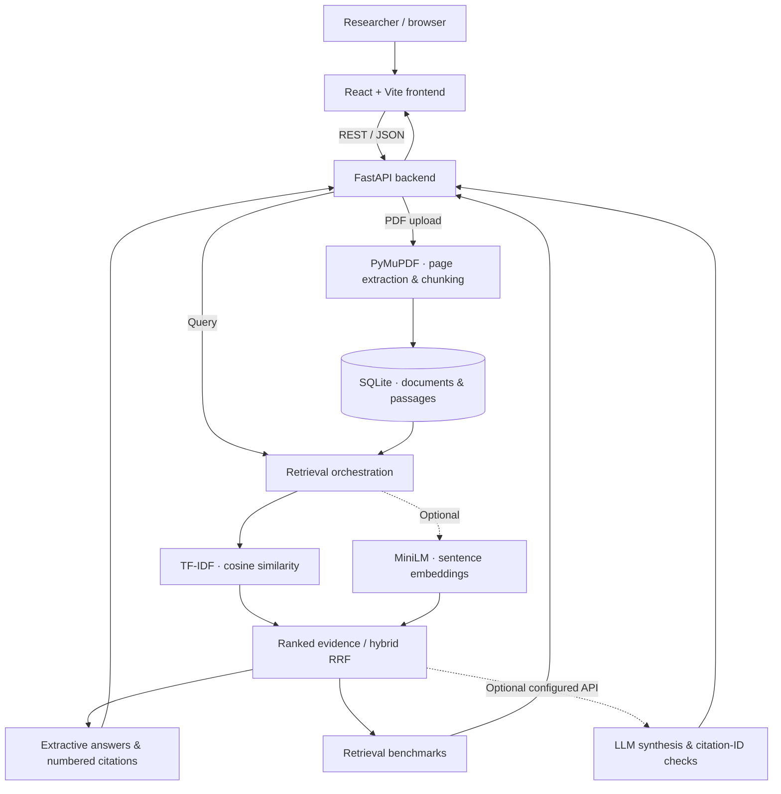

<div align="center">

# ResearchPilot AI Pro

### Evidence-First Research Intelligence · Full-Stack AI Engineering

**Analyze PDFs. Retrieve the evidence. Trace answers back to source pages. Evaluate search quality.**

[](https://github.com/aqibsolangiali/ResearchPilot_AI_Pro/actions/workflows/test.yml)


[**Live web application**](https://researchpilot-ai-pro-1.onrender.com/) · [**GitHub source**](https://github.com/aqibsolangiali/ResearchPilot_AI_Pro) · [**Backend health**](https://researchpilot-ai-pro.onrender.com/api/health) · [**Security notes**](SECURITY.md)

</div>

---

## Overview

**ResearchPilot AI Pro** is a full-stack research platform built to turn academic PDFs into a searchable collection of source-linked evidence. It combines document ingestion, lexical information retrieval, optional neural embeddings, extractive question answering, and transparent retrieval evaluation in a React + FastAPI application.

Rather than presenting untraceable AI responses as facts, the default workflow shows **relevant passages, original PDF filenames, and page numbers**. An optional LLM integration supports generated synthesis, but citation-ID checks **do not prove that individual claims are true**.

**Project role:** Independent engineering portfolio project, designed, implemented, tested, documented, and deployed by **Aqib Ali**.

> **Public prototype safety:** The current application does **not** provide accounts, authorization, or per-user document isolation. Its public backend should not receive personal, confidential, or unpublished PDFs. See [SECURITY.md](SECURITY.md) before using or sharing a public deployment. A healthy `/api/health` response confirms the API is online, **not** that all features or security controls are operational.

## What I engineered

- **Architected and deployed** a decoupled full-stack application: **React/Vite** frontend, **Python/FastAPI** REST backend, and independently hosted Render services.
- **Built** a PDF processing pipeline using **PyMuPDF**, page-by-page extraction, overlapping passages, input checks, and **SQLite** indexing.
- **Implemented** lexical document search with **TF-IDF**, word/bigram features, and **cosine similarity**; added optional **MiniLM/Sentence Transformers** embeddings for semantic retrieval.
- **Designed** a hybrid search workflow using **reciprocal-rank fusion** and a lexical fallback when optional embedding dependencies are unavailable.
- **Developed** source-grounded Q&A that returns relevant evidence alongside **document and page citations**, and optional AI synthesis through an OpenAI-compatible chat-completions API.
- **Engineered** a paper comparison workflow and retrieval benchmarks calculating **Precision@k, Recall@k, MRR, nDCG@k, and latency** from user-labeled relevance data.
- **Added** automated Python API tests and a GitHub Actions pipeline to test the backend and build the frontend.

## Product capabilities

| Capability | What it does | Availability |
| --- | --- | --- |
| Multi-PDF ingestion | Validates PDF files, extracts text by page, chunks and indexes passages | Included |
| Research library | Stores document metadata and extracted passages in SQLite | Included; single backend store |
| Lexical retrieval | Ranks passages with TF-IDF and cosine similarity | Included |
| Semantic retrieval | Uses Sentence Transformers / MiniLM embeddings | Optional installation |
| Hybrid retrieval | Fuses lexical and semantic rankings; falls back when embeddings are unavailable | Included with optional semantic component |
| Evidence-first Q&A | Returns extractive passages with filenames, pages, and citations | Included |
| Generative answers | Sends retrieved context to a configured OpenAI-compatible model | Optional API credentials; **not enabled on the current hosted backend** |
| Citation checks | Validates numbered citation IDs against returned passages | Included; **not factual verification** |
| Paper comparison | Displays retrieved passages side-by-side across selected papers | Included |
| Retrieval benchmarking | Computes labeled ranking metrics plus query latency | Included API; requires human relevance labels |
| Authentication / private workspaces | Separates files and permissions by user | **Not implemented** |
| OCR for scanned PDFs | Recognizes text inside scanned images | **Not implemented** |

## Architecture



**Design choices:** Retrieved passages keep filename/page provenance. Lexical search works without a paid API. Embeddings are optional and currently recomputed for searches; the service uses SQLite rather than a production-grade multi-user data layer. Hybrid retrieval should not be mistaken for an always-active semantic model on Render.

## Demo and screenshots

**Live demo:** https://researchpilot-ai-pro-1.onrender.com/

**API health:** https://researchpilot-ai-pro.onrender.com/api/health

**Suggested demo flow (local or secured deployment):**
1. Open **Document library** and add a **public-domain or synthetic** text PDF.
2. Ask a question in **Research workspace** to inspect cited evidence.
3. Open **AI Research Studio** to compare lexical / optional hybrid retrieval.
4. Use **Compare studies** and **Evaluation lab** for evidence review and basic coverage tests.
5. For labeled ranking benchmarks, submit known-relevant chunk IDs to the v2 benchmark API.

> **Screenshots:** Real product images are intentionally not fabricated. Capture the running application and save files as `docs/screenshots/dashboard.png`, `docs/screenshots/research-studio.png`, and `docs/screenshots/comparison.png`. After capturing, uncomment the image links below. See [the screenshot guide](docs/screenshots/README.md).
>
> <!--  -->
> <!--  -->
> <!--  -->

## Technology stack

| Area | Technology |
| --- | --- |
| Frontend | React, JavaScript, Vite, CSS, Lucide React |
| Backend | Python, FastAPI, Pydantic, Uvicorn |
| Document processing | PyMuPDF, overlapping text chunking |
| Information retrieval | scikit-learn, TF-IDF, cosine similarity, NumPy |
| Optional semantic retrieval | Sentence Transformers, MiniLM |
| Persistence | SQLite |
| Optional AI synthesis | OpenAI-compatible Chat Completions API via HTTPX |
| Testing / automation | pytest, FastAPI TestClient, GitHub Actions |
| Hosting | Render Web Service + Render Static Site |

## Project structure

```text
ResearchPilot_AI_Pro/
├── .github/workflows/test.yml     # CI: Python tests + React build
├── backend/
│   ├── app/main.py                # PDF workflows, retrieval, Q&A and evaluation APIs
│   ├── requirements.txt
│   ├── requirements-semantic.txt   # Optional embedding stack
│   └── tests/                     # API integration and v2 endpoint tests
├── frontend/
│   ├── src/main.jsx               # React UI and API calls
│   ├── src/styles.css
│   ├── package.json
│   └── vite.config.js
├── docs/
│   ├── v1-archive.md              # Original v1 documentation
│   └── screenshots/README.md      # Instructions for real screenshots
├── .env.example
├── .gitignore
├── SECURITY.md
└── README.md
```

## Run locally (Windows)

**Requirements:** Python **3.12**, Node.js **22 LTS** (recommended), npm. The project was also started locally with Node.js 26, but Node 22 matches the repository's CI runtime.

Clone from [GitHub](https://github.com/aqibsolangiali/ResearchPilot_AI_Pro) or download the repository ZIP, then open the extracted `ResearchPilot_AI_Pro` folder in VS Code.

### Terminal 1 — backend

Run these commands **one at a time** inside the project root:

```powershell
cd backend
py -3.12 -m venv .venv
.\.venv\Scripts\python.exe -m pip install -r requirements.txt
.\.venv\Scripts\python.exe -m uvicorn app.main:app --reload --port 8000
```

The API health endpoint should be available at **http://localhost:8000/api/health** and interactive API documentation at **http://localhost:8000/docs**.

### Terminal 2 — frontend

Open a **second terminal** at the project root:

```powershell
cd frontend
npm.cmd install
npm.cmd run dev
```

Open **http://localhost:5173/**. Keep both terminals running. The local Vite development proxy forwards `/api` requests to the backend.

### Optional semantic retrieval

The default backend dependencies support lexical search. For local transformer embeddings, stop the backend, enter the `backend` directory and run:

```powershell
.\.venv\Scripts\python.exe -m pip install -r requirements-semantic.txt
.\.venv\Scripts\python.exe -m uvicorn app.main:app --reload --port 8000
```

The first semantic query may download model weights. Without the optional package, **hybrid mode falls back to lexical retrieval**; explicit semantic-only mode may return a service-unavailable error.

### Optional LLM synthesis

To enable model-generated answers **on a trusted personal backend**, configure `OPENAI_API_KEY` and, optionally, `OPENAI_MODEL`. For an existing local PowerShell terminal:

```powershell
$env:OPENAI_API_KEY="YOUR_PRIVATE_API_KEY"
$env:OPENAI_MODEL="gpt-4.1-mini"
```

Then restart the backend from that terminal. **Do not paste real keys into GitHub, frontend code, client-side environment variables, screenshots or logs.** An LLM may incur provider charges and can still make incorrect claims. The hosted health response previously showed `"llm_enabled": false`.

## API reference

| Method | Route | Purpose |
| --- | --- | --- |
| `GET` | `/api/health` | API health and optional LLM configuration status |
| `GET`, `POST` | `/api/documents` | List and ingest PDFs |
| `DELETE` | `/api/documents/{doc_id}` | Delete indexed documents |
| `POST` | `/api/search` | Lexical passage search |
| `POST` | `/api/ask` | Extractive source-grounded response |
| `POST` | `/api/compare` | Multi-document evidence comparison |
| `POST` | `/api/evaluate` | Retrieval coverage and latency |
| `POST` | `/api/v2/search` | Lexical / semantic / hybrid retrieval |
| `POST` | `/api/v2/ask` | Extractive or optional LLM answer |
| `POST` | `/api/v2/benchmark` | Human-labeled ranking evaluation |
| `GET` | `/api/v2/stats` | Document statistics and optional feature availability |

### Example: manually labeled retrieval benchmark

First, query `/api/v2/search`, review the results, and identify truly relevant chunk IDs. Then submit a benchmark case such as:

```json
{
  "k": 5,
  "mode": "lexical",
  "cases": [
    {
      "question": "Which methods were used?",
      "relevant_chunk_ids": ["INSERT_ACTUAL_RELEVANT_CHUNK_ID"],
      "document_ids": []
    }
  ]
}
```

The benchmark produces **Precision@k, Recall@k, MRR, nDCG@k and mean latency**. Results are only meaningful when relevance labels are valid. They do **not** demonstrate generated-answer factual accuracy.

## Testing and continuous integration

The repository runs **pytest** API integration tests and a frontend build in **GitHub Actions**. Local backend test command from the project root:

```powershell
cd backend
.\.venv\Scripts\python.exe -m pytest -q
```

**Latest local verification while preparing this README:** 5 backend tests passed in the supplied project snapshot. This is **not** a claim of production security, complete test coverage, or successful frontend deployment. The GitHub Actions badge above reflects the current workflow status when GitHub displays it.

## Render deployment configuration

**Backend — Web Service**

| Setting | Value |
| --- | --- |
| Root directory | `backend` |
| Build command | `pip install -r requirements.txt` |
| Start command | `uvicorn app.main:app --host 0.0.0.0 --port $PORT` |
| `CORS_ORIGINS` | `https://researchpilot-ai-pro-1.onrender.com` |

**Frontend — Static Site**

| Setting | Value |
| --- | --- |
| Root directory | `frontend` |
| Build command | `npm install && npm run build` |
| Publish directory | `dist` |
| `VITE_API_URL` | `https://researchpilot-ai-pro.onrender.com` |

Set `VITE_API_URL` **before** building the frontend. Use your service's actual origin and omit a trailing `/api`. `CORS_ORIGINS` is **not** an authentication mechanism. A persistent database and access controls are needed for safe public document handling.

## Engineering limitations and roadmap

**Current limitations:** No user authentication or per-user file isolation; exposed document operations on an unauthenticated backend; no scan-image OCR; SQLite on single-instance local storage; optional semantic embeddings recomputed per query; no verified claim-level entailment for LLM synthesis; no published independently labeled benchmark results. Render free instances may lose local database files on restart or redeployment.

**Next engineering milestones:**

- [ ] **P0 — Secure the public API:** authentication, per-user authorization, restricted uploads/deletes, size/rate limits, private object storage, and controlled data retention.
- [ ] **P1 — Make the demo safe:** public synthetic sample dataset and read-only demonstration endpoints; clearly label demo content.
- [ ] **P1 — Add real screenshots and a short product walkthrough:** use safe, synthetic research material.
- [ ] **P1 — Strengthen automated verification:** integration, security, and browser end-to-end tests plus coverage reporting.
- [ ] **P2 — Persist and scale:** PostgreSQL, durable object storage, cached embeddings/vector index, and migrations.
- [ ] **P2 — Evaluate rigorously:** manually adjudicated relevance corpus, benchmark tables, and citation-to-claim verification tests.
- [ ] **P3 — Extend documents:** scanned-PDF OCR, accessible file handling, and improved paper comparison.

## Author

**Aqib Ali** — Software Engineering · AI/NLP · Research Technology

[GitHub](https://github.com/aqibsolangiali) · [LinkedIn](https://www.linkedin.com/in/aqib-ali-54b872443) · [Live ResearchPilot demo](https://researchpilot-ai-pro-1.onrender.com/)

*Independent engineering portfolio prototype. Not affiliated with an academic publisher or university. See [archived v1 notes](docs/v1-archive.md) for project history.*
