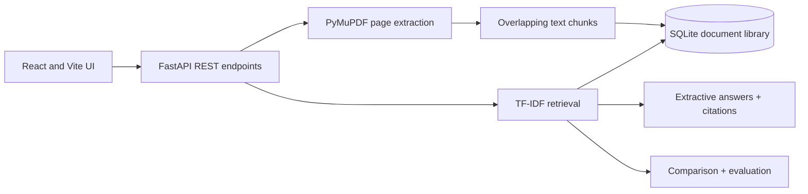

# ResearchPilot AI — Archived v1 Notes

> Historical documentation preserved from the original repository. For the current v2 project, see [the main README](../README.md).

# ResearchPilot AI — Evidence-first academic research workspace

> **Full-stack, local-first research assistant** for importing PDFs, finding relevant passages, citing source pages, comparing documents, and measuring retrieval performance.

## Highlights

- **Multi-PDF ingestion:** validates PDF format, enforces 12 MB / 150 page limits, extracts per-page text with PyMuPDF, and creates overlapping passages.
- **Cited research answers:** extracts relevant source sentences and shows the original passages with PDF name and page numbers; explicitly states when evidence is insufficient.
- **Research search:** weighted TF–IDF word and phrase retrieval, top-k ranking, and relevance scores.
- **Cross-paper comparison:** presents evidence from multiple papers side by side for reviewing methods, findings, and limitations.
- **Evaluation lab:** batches test questions; reports retrieval coverage, scores, and latency. **Coverage is not ground-truth accuracy.**
- **Research library:** documents stored in SQLite with per-page chunks, delete support, and document scoping.
- **Polished React frontend:** interactive library, document upload, grounded Q&A, source panels, comparison, evaluation, mobile-responsive interface.
- **Tests and CI:** pytest/FastAPI tests plus GitHub Actions for backend and frontend builds.

## Architecture



## Local development

**Requirements:** Python 3.11–3.13, Node.js 22 LTS, npm. If using Python 3.14 or Node.js 26, some dependencies may behave differently; use the recommended versions if installation fails.

**Terminal 1: API**

```powershell
cd backend
py -3.12 -m venv .venv
.venv\Scripts\python.exe -m pip install -r requirements.txt
.venv\Scripts\python.exe -m uvicorn app.main:app --reload --port 8000
```

For macOS/Linux, create and activate your virtual environment with your platform's Python executable and run the same pip/uvicorn commands. The backend health route is `http://localhost:8000/api/health`, and interactive API docs are at `http://localhost:8000/docs`.

**Terminal 2: React UI**

```powershell
cd frontend
npm install
npm run dev
```

Open **http://localhost:5173**. Local Vite development proxies `/api` to the backend automatically.

## Production-style deployment

Deploy `backend` as a Python web service and `frontend` as a Vite static site. For a Render backend, build command: `pip install -r requirements.txt`; start command: `uvicorn app.main:app --host 0.0.0.0 --port $PORT`. For frontend, root `frontend`, build `npm install && npm run build`, publish `dist`.

Set `VITE_API_URL` to your backend's public HTTPS origin (no trailing `/api`) in the **frontend static-site environment before building**. Set backend `CORS_ORIGINS` to your frontend's exact origin.

**Production cautions:** The SQLite store is local to one instance and is ephemeral on some cloud hosts. The prototype does **not** implement accounts, permissions, multi-tenant isolation, file encryption, malware scanning, or persistent blob storage. **Do not upload confidential research or personally identifying PDFs to a publicly deployed demo.** For a production system, add authenticated per-user libraries, object storage, PostgreSQL, rate limits, file scanning, monitoring, and retention policies.

## API endpoints

| Method | Endpoint | Purpose |
| --- | --- | --- |
| GET | `/api/health` | Service health |
| GET / POST | `/api/documents` | List or upload PDFs |
| DELETE | `/api/documents/{doc_id}` | Delete a PDF's indexed content |
| POST | `/api/search` | Search source passages |
| POST | `/api/ask` | Extractive response with numbered citations |
| POST | `/api/compare` | Evidence passages across selected papers |
| POST | `/api/evaluate` | Query-set coverage and latency |

## Testing

```bash
cd backend
python -m pytest -q
cd ../frontend
npm install
npm run build
```

## Limitations and next research milestones

**This is not a generative LLM system yet.** The default answer generator selects *verbatim sentences* from top-ranked passages and labels them with source references; extraction may be irrelevant despite nonzero similarity. Page citations are grounded to extracted page text, but that does not guarantee an interpretation is correct. No OCR for scanned PDFs. Vector embeddings, RAG generation, scientific comparison extraction, reranking, page highlighting, ground-truth relevance annotation, recall@k, precision@k, MRR, NDCG, and citation-faithfulness evaluation are future milestones.

For a genuine advanced AI extension: use local sentence embeddings and pgvector, add hybrid BM25+semantic retrieval, train a cross-encoder reranker, introduce an optional LLM synthesis layer constrained to cited source IDs, build human-reviewed evaluation datasets, and publish benchmark results. Avoid representing future features as completed work.

## Developer

**Aqib Ali** · [GitHub](https://github.com/aqibsolangiali) · [LinkedIn](https://www.linkedin.com/in/aqib-ali-54b872443)

Independent portfolio demonstration; not affiliated with a university or research publisher.
